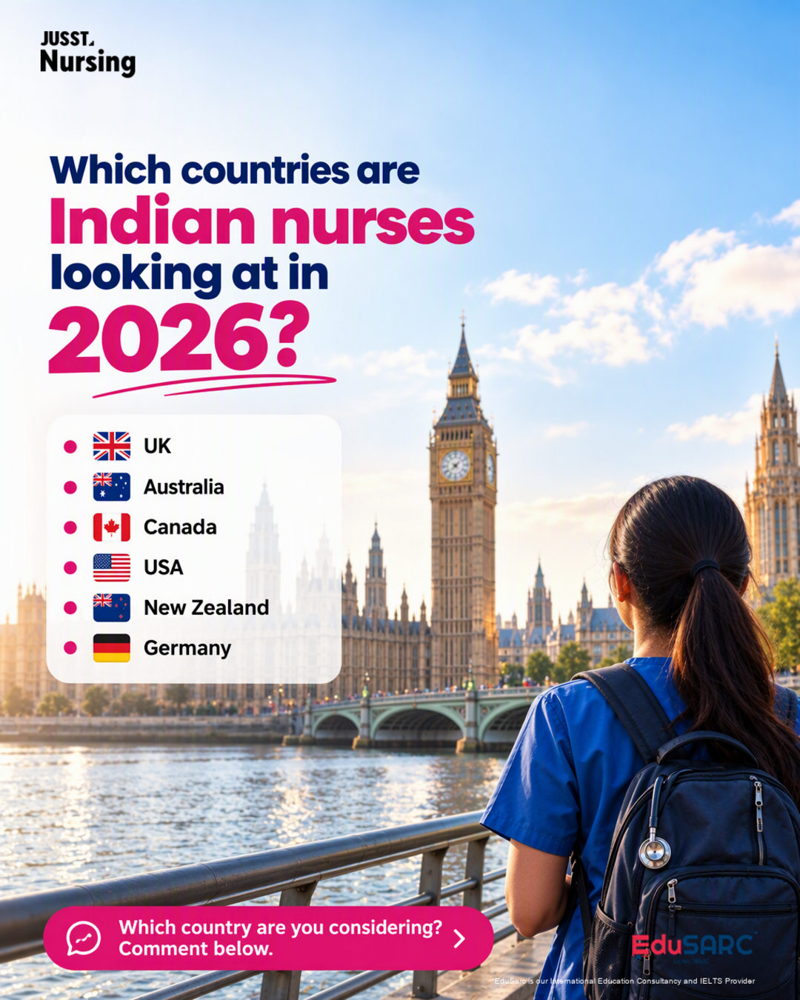
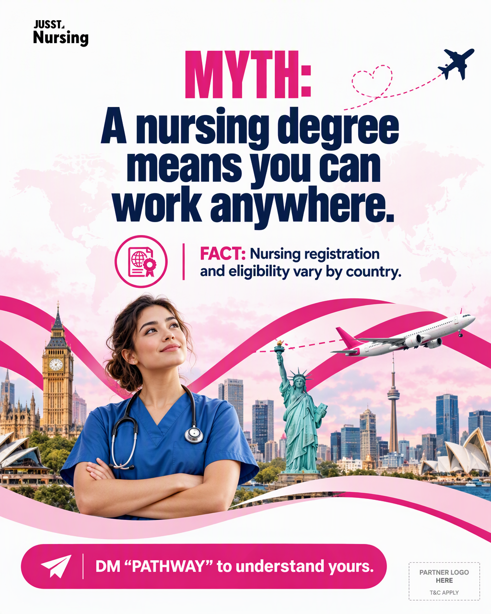
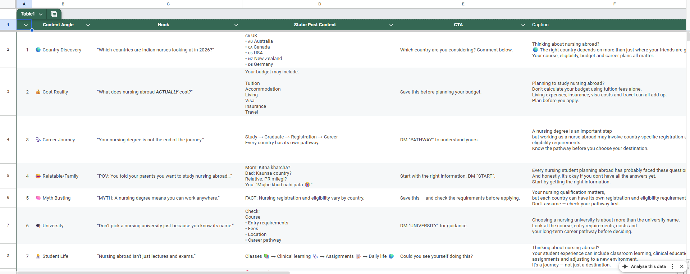

# Instagram AI Creative Generator + Scheduler (n8n)

Two n8n workflows that take a **content row from Google Sheets** (hook, points, CTA, caption) and turn it into a **brand-consistent Instagram creative**. The creative is laid out like the best-matching reference design, with the brand logos added. A **Gmail approval** step comes next, and after you click *Approve* the post is **scheduled to Instagram through Buffer**. **Nothing is posted without a person approving it.**

**Stack:** n8n · Google Sheets (content brief + content calendar) · Google Drive (reference designs, logos, final images) · OpenAI GPT-4.1 / 4.1-mini (reference analysis + selection) · CometAPI `gpt-image` (image-to-image generation) · n8n Edit Image (logo + disclaimer overlay) · Gmail (Approve / Reject email) · Buffer GraphQL API (Instagram post / reel scheduling)

---

## Example output

All of these were generated by Workflow 1 from a single sheet row each:

| Country Discovery | Career Journey | Myth Busting |
|---|---|---|
|  |  |  |
| **Study in Australia** | **Shape Your Future** | |
|  |  | |

Input sheet these were made from:



---

## 1. Workflows

| # | File | Trigger | What it does |
|---|---|---|---|
| 1 | [`workflows/01-ai-creative-generator.json`](workflows/01-ai-creative-generator.json) | Manual | Reads the **Creative Brief** sheet → picks **one** row where `status` is empty (lowest `Day` first) → builds the brand kit + exact on-image copy from the row (no AI-invented text) → lists up to 8 reference designs in Drive → **GPT-4.1 analyses each reference's "composition DNA"** (layout %, hero subject, headline block, footer, density) → **GPT-4.1-mini picks the best-fitting reference** for this post → CometAPI **image-to-image** recreates that layout with the new copy + brand colours (1024×1280) → overlays the brand logo, the partner logo and the disclaimer → resizes to **1080×1350** (Instagram 4:5) → saves `instagram-post-<timestamp>.png` to the output Drive folder → marks the row `Posted` |
| 2 | [`workflows/02-instagram-scheduler-buffer.json`](workflows/02-instagram-scheduler-buffer.json) | Manual + 2 webhooks | **A. Send for approval:** reads the **Content Calendar** → rows with Post ID + Drive URL + Caption that aren't already handled → `Awaiting Approval` → Gmail email with image preview, caption, date/time and **Approve / Reject** buttons. **B. Approve webhook** (`/webhook/social-post-approve`): finds the row → converts date/time (IST) to UTC → Buffer `createPost` mutation (`post` = image, `reel` = video) → writes `Scheduled`, Buffer Post ID and Scheduled At. **C. Reject webhook** (`/webhook/social-post-reject`): marks the row `Rejected` |

```
Creative Brief row ─► AI picks reference ─► image-to-image ─► logos + disclaimer ─► Drive PNG
                                                                                       │
                                                         (add Drive link to Calendar)  ▼
Content Calendar row ─► Gmail Approve/Reject ─► Approve ─► Buffer ─► Instagram (post / reel)
                                              └► Reject ─► row = Rejected
```

## 2. Google Sheets to connect

Templates with sample rows are in [`sheets/`](sheets/). Import them into Google Sheets (File → Import), then select each sheet in the matching n8n nodes.

### Sheet 1: Creative Brief (used by Workflow 1)
Template: [`sheets/creative-brief-template.csv`](sheets/creative-brief-template.csv)

| Column | Required | Example |
|---|---|---|
| Day | ✅ | `1` (processing order, also used to find the row) |
| Content Angle | | `🌍 Country Discovery` (defaults to `Informational`) |
| Hook | ✅ | `"Which countries are Indian nurses looking at in 2026?"` (headline on the image) |
| Static Post Content | ✅ | One point per line (max 6), becomes the bullets on the image |
| CTA | | `Which country are you considering? Comment below.` |
| Caption | | Instagram caption text |
| status | | Leave **empty**. The workflow sets `Posted` after the image is saved |

### Sheet 2: Content Calendar (used by Workflow 2)
Template: [`sheets/content-calendar-template.csv`](sheets/content-calendar-template.csv)

| Column | Required | Example / notes |
|---|---|---|
| Post ID | ✅ | `IG-001` (unique, used in the Approve/Reject links) |
| Post Date | ✅ | `2026-11-03` (also accepts `03-11-2026`, `03/11/2026`) |
| Post Time | ✅ | `18:30` (24h, **Asia/Kolkata**) |
| Post Type | | `post` (image) or `reel` (video). Default `post` |
| Drive Image URL | ✅ | Drive share link of the image/video. The file must be shared as **Anyone with the link** so Buffer can download it |
| Topic | | Shown in the approval email |
| Caption | ✅ | Instagram caption |
| Buffer Status | | Leave empty. Set by the workflow: `Awaiting Approval` → `Scheduled` / `Rejected` |
| Buffer Post ID | | Set by the workflow |
| Scheduled At | | Set by the workflow (UTC) |
| Error | | For notes / errors |

## 3. Google Drive folders

| Folder | Contents |
|---|---|
| **Reference designs** | 3–8 PNG/JPG/WEBP social posts whose layouts you like. The AI copies their *composition*, never their logo or text |
| **Logos** | Brand logo file names must contain `black`, `pink` or `white` (e.g. `logo-black.png`). The partner logo name must contain `edusarc`. Rename the logic in **Choose Logo3** for your own brand |
| **Output** | Final generated images are saved here |

## 4. Setup

1. Import both JSON files into n8n (**Workflows → Import from file**).
2. Create credentials in n8n and select them in every node that shows a warning:
   - Google Sheets OAuth2, Google Drive OAuth2, Gmail OAuth2
   - OpenAI API key (Analyze Each Reference3, Select Best Reference3)
3. Replace the placeholders:

| Placeholder | Where |
|---|---|
| `YOUR_COMETAPI_KEY` | Header of **Comet Image-to-Image3** and **Generate Image - CometAPI** (`Bearer YOUR_COMETAPI_KEY`) |
| `YOUR_BUFFER_API_TOKEN` | Header of **Schedule in Buffer** |
| `YOUR_BUFFER_CHANNEL_ID`, `your_instagram_handle` | **Workflow Config** and **Build Buffer Request** (code) |
| `approver@example.com`, `https://YOUR-N8N-DOMAIN` | **Workflow Config** |
| `YOUR_CREATIVE_BRIEF_SHEET_ID` | **Get row(s) in sheet**, **Update row in sheet** |
| `YOUR_CONTENT_CALENDAR_SHEET_ID` | All Google Sheets nodes in Workflow 2 |
| `YOUR_REFERENCE_IMAGES_FOLDER_ID`, `YOUR_LOGOS_FOLDER_ID`, `YOUR_OUTPUT_FOLDER_ID` | **List Reference Folder3**, **Find Logo Files2**, **Save Final Image**, **Normalize Sheet Row** (code) |

4. Change the brand guidelines, colours (`#DC287F`, `#0F254B`) and the disclaimer text in **Normalize Sheet Row** and **Add EduSarc Disclaimer Text2** to your own brand.
5. **Activate** Workflow 2 so the Approve / Reject webhooks are live.

> 💡 Tip: store API keys as n8n **Header Auth credentials** instead of typing them into the HTTP node, so they are never exported with the workflow.

## 5. Notes

- The **Generate Image - CometAPI** branch in Workflow 1 is a standalone text-to-image test and is not connected to the main flow.
- Workflow 1 handles **one row per run** on purpose, because the merge nodes expect a single post.
- Approve/Reject links are plain GET webhooks. Keep the approval emails private, or add a secret token to the URL for production.
